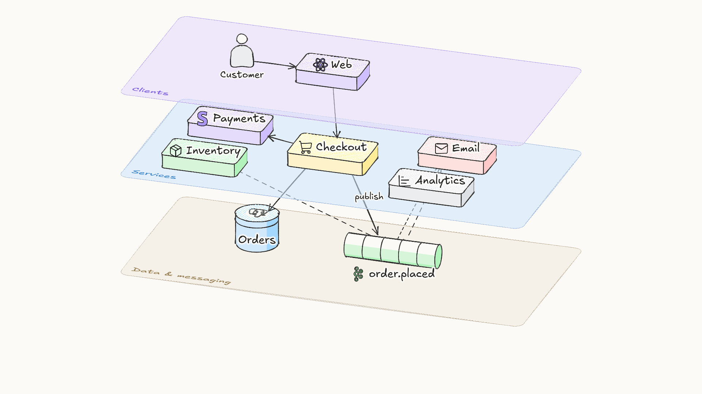

# Sketchdeck

Present architectural decisions as hand-drawn, 2.5D scenes. An agent writes the deck as data; Sketchdeck draws it in an Excalidraw-like style on stacked layer planes and plays it back step by step. The camera tells the story, and everything comes to rest once a step has made its point.



## Quick start

```bash
npm install
node cli/sketchdeck.mjs dev decks/checkout-events/deck.ts
```

Use → to step through, E to explore, and P for the presenter view. Headless rendering uses your installed Google Chrome.

## For agents

Start with [CLAUDE.md](CLAUDE.md). It covers the workflow; [docs/TASTE.md](docs/TASTE.md) explains what makes a deck good, and [docs/AUTHORING.md](docs/AUTHORING.md) is the format reference.

```bash
node cli/sketchdeck.mjs check  decks/<name>/deck.ts   # types, validation, layout lint
node cli/sketchdeck.mjs render decks/<name>/deck.ts   # PNG per step, to look at
```

## Credits

Excalifont (SIL OFL 1.1) by Excalidraw. Stroke style ported from rough.js (MIT). Icons derived from Lucide (ISC) and Simple Icons (CC0); brand marks belong to their owners. See `assets/`.
